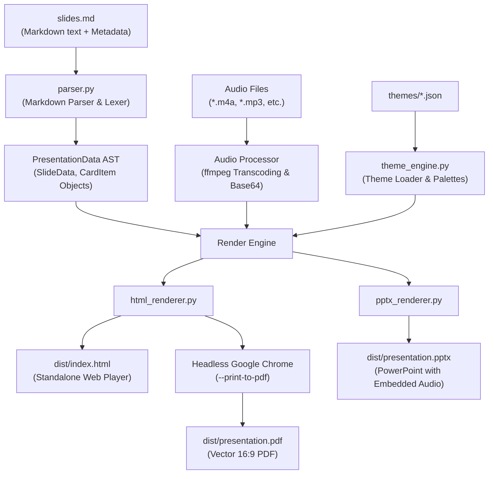

# System Architecture & Technical Documentation

This document describes the internal architecture, technical background, and data flow of the **Slideshow Generator**.

---

## 1. System Overview

The goal of this platform is to convert plain Markdown outlines (`slides.md`) accompanied by optional slide-level audio files (`.m4a`, `.mp3`) into professional, 16:9 widescreen presentations across three first-class output formats:

1. **Microsoft PowerPoint (`presentation.pptx`)**: Standard PowerPoint file with native embedded audio shapes (click-to-play narration).
2. **Interactive Web Presentation (`index.html`)**: Fully self-contained, zero-dependency HTML5/CSS3/JavaScript slideshow with embedded Base64 audio, live duration/progress tracker, keyboard navigation, and card-based responsive layout.
3. **Vector PDF (`presentation.pdf`)**: Pixel-perfect, 16:9 widescreen printable and presentable PDF export.

---

## 2. Architecture & Data Pipeline

The generator employs a deterministic, multi-stage processing pipeline:



---

## 3. Directory Layout & Components

```
slideshowGenerator/
├── docs/                       # System & architectural documentation
│   ├── ARCHITECTURE.md         # Detailed technical background and components
│   └── DECISIONS.md            # Architecture Decision Records (ADRs)
├── generator/
│   ├── models.py               # AST data models (SlideData, CardItem, ThemeConfig)
│   ├── parser.py               # Markdown parser & card layout extractor
│   ├── theme_engine.py         # JSON theme loader, validator, and manager
│   ├── theme_generator.py      # AI & algorithmic theme generator engine
│   ├── themes/                 # Declarative JSON style definitions
│   │   ├── schema.json         # JSON Schema for theme validation
│   │   ├── modern_clean.json   # Default crisp light theme with blue accents
│   │   ├── dark_mode.json      # Premium slate dark theme
│   │   ├── emerald_growth.json # Natural green theme
│   │   ├── warm_academic.json  # Warm cream & burgundy academic style
│   │   └── THEME_PROMPT.md     # Prompt guidelines for generating new AI themes
│   ├── renderers/              # Format-specific rendering engines
│   │   ├── html_renderer.py    # Interactive standalone HTML5 presentation renderer
│   │   ├── pptx_renderer.py    # PowerPoint generator (python-pptx)
│   │   └── pdf_renderer.py     # Headless Chrome vector PDF exporter
│   └── cli.py                  # CLI entry point and reusable TCP web server
├── slideshow_1/                # Living reference example
│   ├── slides.md               # Source markdown with audio metadata
│   ├── slide_title.m4a         # Recorded narration audio
│   └── dist/                   # Output artifacts (ignored by git)
├── run.py                      # Root launcher with automatic .venv detection
├── requirements.txt            # Python dependencies (python-pptx, pillow, lxml)
├── AGENTS.md                   # Guidelines and mandatory rules for AI agents
└── README.md                   # User guide and CLI instructions
```

---

## 4. Component Details

### 4.1. Parser & Internal AST (`generator/parser.py`, `models.py`)
- **Slide Delimiters**: Supports `# Title`, `# Slide`, and `---` horizontal rules.
- **Metadata Extraction**:
  - `<!-- audio: filename.m4a -->`: Associates an audio track with the slide.
  - `<!-- notes: ... -->`: Speaker notes.
  - `<!-- type: ... -->`: Manual layout type override (`title`, `cards`, `definition`).
- **Card Detection & Continuity**:
  - Bullet items (`- Title: Description`) are transformed into visual `CardItem` blocks.
  - **Continuous Numbering**: Sequential card slides maintain a running counter (e.g., Slide 3 displays badges `01, 02`, while Slide 4 continues with `03, 04`).
  - **Definition Slide**: Slides without bullet points containing descriptive paragraphs are formatted as highlighted definition/quote cards.

### 4.2. Theming Engine (`generator/themes/`, `theme_engine.py`)
- Themes are completely decoupled from presentation content.
- Each theme is defined in a declarative JSON file specifying:
  - Color palette (`background`, `card_bg`, `card_border`, `primary_text`, `secondary_text`, `accent`, `badge_bg`, `badge_text`).
  - Typography (`title_font`, `body_font`).
  - Geometries (`card_radius_px`, `card_shadow`, `border_width_px`).
- **AI Theme Generation (`theme_generator.py`)**: When `GEMINI_API_KEY` is present, queries Gemini; otherwise, an algorithmic palette synthesizer analyzes keywords (e.g. "dark", "sötét", "green", "zöld", "nordic", "cyberpunk") to immediately produce a valid theme JSON.

### 4.3. HTML Renderer (`generator/renderers/html_renderer.py`)
- **Zero-Dependency Standalone HTML**: Audio tracks are embedded directly into the HTML as Base64 data streams (`data:audio/mpeg;base64,...`). This bypasses browser `file:///` sandbox restrictions and makes the HTML completely portable.
- **Automatic MP3 Transcoding**: If `ffmpeg` is present, proprietary or container-specific audio formats (such as Samsung `3gp4` M4A files) are converted to standard MP3.
- **Multi-Source Audio Fallback**: The `<audio>` element provides three fallback sources: embedded Base64 MP3, relative MP3 file, and original file.
- **16:9 Canvas**: Responsive aspect ratio (`aspect-ratio: 16/9; width: min(100vw, calc(100vh * 16 / 9));`).
- **Interactive Controls**: Keyboard navigation (arrow keys, spacebar, PgUp/PgDown, `F` for fullscreen), live time tracking (`Playing (0:02 / 0:07)`), and animated wave bars.

### 4.4. PowerPoint Renderer (`generator/renderers/pptx_renderer.py`)
- Uses `python-pptx` to build 16:9 widescreen slides (`13.333 × 7.5` inches).
- Renders cards and content blocks as native vector rounded shapes colored according to the selected theme.
- Embeds audio directly into the `.pptx` ZIP package (`ppt/media/media1.m4a`) as a native media shape (`<p14:media>` and `<a:hlinkClick action="ppaction://media">`), triggering playback on click.

### 4.5. PDF Renderer (`generator/renderers/pdf_renderer.py`)
- Leverages the print stylesheet in the HTML (`@media print { @page { size: 16in 9in; margin: 0; } }`).
- Executes Headless Google Chrome:
  ```bash
  google-chrome-stable --headless=new --disable-gpu --no-pdf-header-footer --print-to-pdf=dist/presentation.pdf dist/index.html
  ```
- Produces clean, vector-rendered, 16:9 widescreen PDF slides.

### 4.6. Reusable TCP Web Server (`generator/cli.py`)
- Built-in `--serve` command launches a local HTTP server for testing.
- **Instant Port Reuse**: Implements `ReusableTCPServer` with `SO_REUSEADDR` and `SO_REUSEPORT`, ensuring that on `Ctrl + C`, the socket descriptor is immediately closed without lingering in Linux `TIME_WAIT`.
