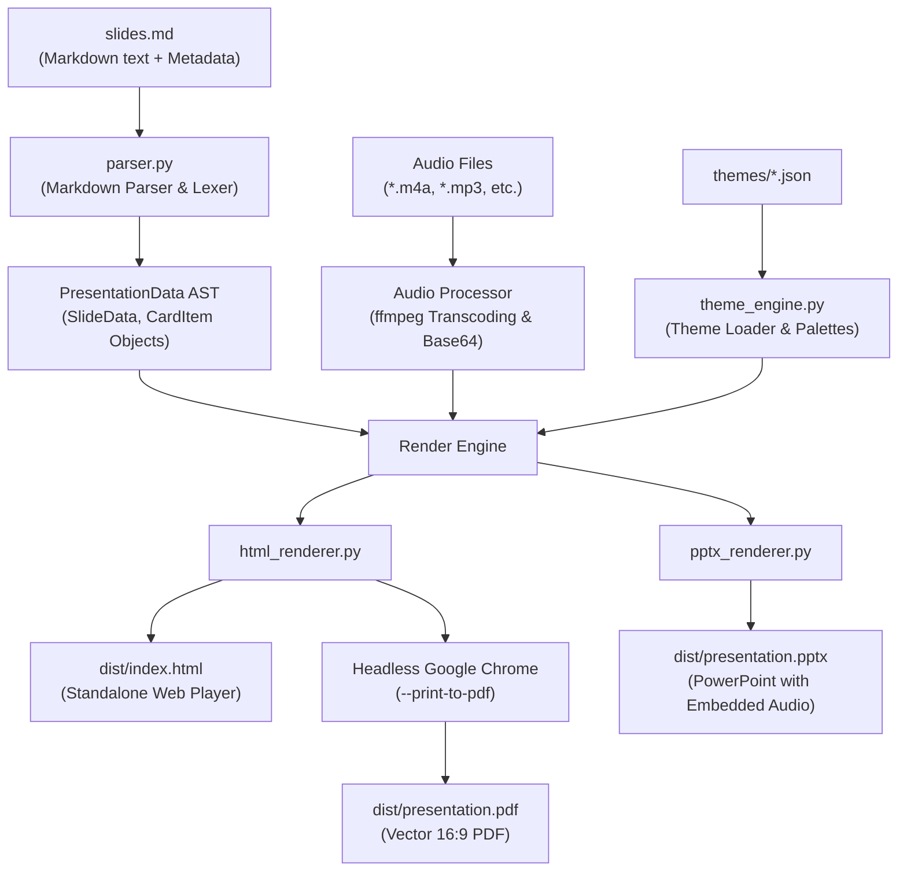

# System Architecture & Technical Documentation

This document describes the internal architecture, technical background, and data flow of the **Slideshow Generator**.

---

## 1. System Overview

The goal of this platform is to convert plain Markdown outlines (`slides.md`) accompanied by optional slide-level audio files (`.m4a`, `.mp3`) into professional, 16:9 widescreen presentations across three first-class output formats:

1. **Microsoft PowerPoint (`presentation.pptx`)**: Standard PowerPoint file with native embedded audio shapes (click-to-play narration).
2. **Interactive Web Presentation (`index.html`)**: Fully self-contained, zero-dependency HTML5/CSS3/JavaScript slideshow with embedded Base64 audio, live duration/progress tracker, keyboard navigation, and card-based responsive layout.
3. **Vector PDF (`presentation.pdf`)**: Pixel-perfect, 16:9 widescreen printable and presentable PDF export.

---

## 2. Architecture & Data Pipeline

The generator employs a deterministic, multi-stage processing pipeline:



---

## 3. Directory Layout & Components

```
slideshowGenerator/
├── docs/                       # System & architectural documentation
│   ├── ARCHITECTURE.md         # Detailed technical background and components
│   └── DECISIONS.md            # Architecture Decision Records (ADRs)
├── generator/
│   ├── models.py               # AST data models (SlideData, CardItem, ThemeConfig)
│   ├── parser.py               # Markdown parser & card layout extractor
│   ├── theme_engine.py         # JSON theme loader, validator, and manager
│   ├── theme_generator.py      # AI & algorithmic theme generator engine
│   ├── themes/                 # Declarative JSON style definitions
│   │   ├── schema.json         # JSON Schema for theme validation
│   │   ├── modern_clean.json   # Default crisp light theme with blue accents
│   │   ├── dark_mode.json      # Premium slate dark theme
│   │   ├── emerald_growth.json # Natural green theme
│   │   ├── warm_academic.json  # Warm cream & burgundy academic style
│   │   └── THEME_PROMPT.md     # Prompt guidelines for generating new AI themes
│   ├── renderers/              # Format-specific rendering engines
│   │   ├── html_renderer.py    # Interactive standalone HTML5 presentation renderer
│   │   ├── pptx_renderer.py    # PowerPoint generator (python-pptx)
│   │   └── pdf_renderer.py     # Headless Chrome vector PDF exporter
│   └── cli.py                  # CLI entry point and reusable TCP web server
├── slideshow_1/                # Living reference example
│   ├── slides.md               # Source markdown with audio metadata
│   ├── slide_title.m4a         # Recorded narration audio
│   └── dist/                   # Output artifacts (ignored by git)
├── run.py                      # Root launcher with automatic .venv detection
├── requirements.txt            # Python dependencies (python-pptx, pillow, lxml)
├── AGENTS.md                   # Guidelines and mandatory rules for AI agents
└── README.md                   # User guide and CLI instructions
```

---

## 4. Component Details

### 4.1. Parser & Internal AST (`generator/parser.py`, `models.py`, `markdown_utils.py`)
- **Slide Delimiter Strategies**:
  - **Explicit Rules Mode**: If a document uses `---` horizontal rules or legacy `# Slide` / `# Title` markers, slides split strictly at these markers. In-slide `# ` and `## ` headings belong to the slide as titles or subtitles without triggering unwanted slide splits.
  - **Standard Markdown H1 Mode**: If a document contains neither `---` nor `# Slide`, top-level `# Heading` (H1) tags delimit slides.
  - **Fenced Code Safety**: Fenced code blocks (```` ```python ... ``` ````) track state so internal `#` code comments are never misidentified as slide boundaries.
- **Title Extraction & Sanitization (`markdown_utils.strip_markdown`)**:
  - Automatically identifies titles from `# `, `## `, bold markers `**Title**`, or leading terms.
  - Sanitizes formatting markers so PowerPoint headers and HTML titles display clean plain text without raw asterisks or hashes.
- **In-Slide Markdown Structures**:
  - **Definition Lists**: Pandoc/PHP Markdown Extra format (`Term\n: Definition line`) parsed directly into visual `CardItem` blocks.
  - **Structured Bullet Cards**: Multi-line bullets with indented sub-properties (`- Term:\n  **Prop**: Val`) or single-line colon items (`Term: Description`) converted to `CardItem` objects.
  - **Visual Cards (`### ` or `## `)**: Sub-headings within content lines create structured card blocks.
  - **Blockquotes (`> `)**: Rendered as prominent definition / quote cards.
  - **Fenced Code Blocks**: Highlighted monospace dark code container in PPTX and HTML.
  - **Lists & Auto-Linking**: Bullet lists, numbered lists, and raw URL auto-linking.
- **Dynamic Deck Branding**:
  - Category lead tags and title pill badges dynamically display the presentation title (`PresentationData.title`) instead of hardcoded demo labels.
- **Metadata Extraction**:
  - `<!-- audio: filename.m4a -->`: Associates an audio track with the slide.
  - `<!-- notes: ... -->`: Speaker notes.
  - `<!-- type: ... -->`: Manual layout type override (`title`, `cards`, `definition`, `code`, `standard`).
- **Continuous Numbering**: Sequential card slides maintain a running counter (e.g. `01, 02` on slide 3, continuing to `03, 04` on slide 4).

#### Markdown-to-Slide Element Mapping Reference:
| Markdown Syntax | AST Element | Slide Layout / Component | Notes & Styling |
|---|---|---|---|
| `---` or `# Slide` or `# ` (H1) | Slide boundary | **Slide Transition** | Delimits slides. Delimiter mode automatically avoids phantom slides. |
| `# Title` (Slide 1) | `SlideType.TITLE` | **Title Slide** | Displays main deck title, presenter pill, and author credit. |
| `# Header` or `## Header` or `**Title**` | `slide.title` | **Slide Header** | Cleaned of asterisks/hashes. Styled with theme title font and accent colors. |
| `### Card Title`<br/>`Description` | `CardItem` | **Info Card Box** | Floating card with sequential numeric index badge (`01`, `02`). |
| `Term:`<br/>`: Definition line 1`<br/>`: Definition line 2` | `CardItem` | **Definition Card Box** | Standard Markdown definition list rendered into visual cards. |
| `- Term:`<br/>`  **Prop**: Value` | `CardItem` | **Property Card Box** | Indented multi-line bullets converted into card containers. |
| `- Title: Description`<br/>`Title: Description` | `CardItem` | **Key-Value Card Box** | Single-line colon syntax parsed into structured cards. |
| `| Col 1 | Col 2 |`<br/>`| :--- | :---: |` | `TableData` | **Table Slide** (`SlideType.TABLE`) | Formatted table with text alignments (left/center/right) across HTML, PPTX, and PDF. |
| `` | `ImageData` | **Hero Image / Split Layout** | Standalone hero slide (`SlideType.IMAGE`) or split side-by-side layout alongside text. |
| `- [x] Done`<br/>`- [ ] Pending` | Task list token | **Task List** | Custom styled checkboxes (HTML) and checkmark bullets `☑` / `☐` (PPTX). |
| `> Quote or definition` | `slide.quote` | **Definition Slide** | Large decorative quotation card (`“`) with accent left border. |
| ```` ```python ````<br/>`def code():...`<br/>```` ``` ```` | `slide.code_snippet` | **Code Block Slide** | Dark IDE container with monospace code font and language badge. |
| `- Item`<br/>`* Item`<br/>`1. Item` | `slide.list_items` | **Styled Content List** | Clean bullet list with colored circular bullet points. |
| Leading / trailing paragraphs | `slide.paragraphs` | **Intro / Footnote Text** | Lead subtitle above cards or italicized note below cards. |
| `Készítette: Név`<br/>`Author: Name` | `slide.author` | **Author Line** | Presenter credit with left decorative accent bar. |
| `**bold**` or `__bold__` | Bold token | **Bold Text** | `<strong>` in HTML; native `run.font.bold` in PowerPoint. |
| `*italic*` or `_italic_` | Italic token | **Italic Text** | `<em>` in HTML; native `run.font.italic` in PowerPoint. |
| `~~strikethrough~~` | Strike token | **Strikethrough** | `<del>` in HTML; native OpenXML `sngStrike` in PowerPoint. |
| `==highlight==` | Highlight token | **Highlighted Text** | `<mark>` in HTML; native DrawingML `<a:highlight>` in PowerPoint. |
| `^superscript^` | Sup token | **Superscript** | `<sup>` in HTML; native `30000` baseline shift in PowerPoint. |
| `~subscript~` | Sub token | **Subscript** | `<sub>` in HTML; native `-25000` baseline shift in PowerPoint. |
| `` `code` `` | Code chip | **Inline Code Pill** | Rounded chip in HTML; Consolas monospace run in PowerPoint. |
| `[link](url)` or raw `https://...` | Link token | **Clickable Link** | `<a href>` in HTML; labeled hyperlink in PowerPoint. |
| `<!-- audio: file.m4a -->` | `slide.audio_filename` | **Audio Widget** | Base64 standalone player in HTML; native audio shape in PPTX. |
| `<!-- notes: ... -->` | `slide.notes` | **Speaker Notes** | Presenter notes available during delivery. |
| `<!-- type: ... -->` | `slide.slide_type` | **Layout Override** | Explicitly forces `title`, `cards`, `definition`, `code`, `table`, `image`, or `standard`. |

### 4.2. Theming & Structural Archetypes (`generator/themes/`, `theme_engine.py`)
Visual appearance is governed by two orthogonal dimensions:
1. **Color Palette (Themes)**: Configured in `generator/themes/*.json` (e.g. `warm_academic.json`, `bold_neubrutalism.json`, `dark_terminal.json`). Controls color tokens (`background`, `card_bg`, `card_border`, `primary_text`, `secondary_text`, `accent`, `badge_bg`, `badge_text`).
2. **Structural Styling (Archetypes)**: Defined by the `ArchetypeType` enum (`editorial`, `cards`, `neubrutalism`, `terminal`, `minimal`, `corporate`). Dictates card framing, border thickness, drop shadows, typography hierarchy, and shape geometry across all renderers.

#### The 6 Visual Archetypes:
- **`editorial`**: Refined academic/book/magazine aesthetic. Transparent cards with fine hairline dividing rules or subtle vertical left-accent lines, elegant Georgia serif typography, no heavy card boxes.
- **`cards`**: Elevated modern floating UI. Rounded corners (12–16px), soft ambient drop-shadows, subtle border strokes, modern SaaS feel.
- **`neubrutalism`**: High-contrast pop-art aesthetic. Thick solid black borders (2.5–3px), hard unblurred black offset drop shadows (`5px 5px 0px #000`), geometric sharp corners, bold punchy badges.
- **`terminal`**: Hacker / developer console aesthetic. Monospace typography (`JetBrains Mono`, `Consolas`), dark surface, console prompt prefixes (`root@slides:~# `, `>_`), sharp geometry, and subtle grid feel.
- **`minimal`**: Swiss International Typographic Style. Zero borders, zero shadows, transparent cards, oversized numeric indices (`01`, `02`), maximum whitespace, stark typographic contrast.
- **`corporate`**: Executive consulting style (McKinsey / BCG slide archetype). Crisp geometry, solid color top header banner on cards, structured business layout.

#### Orthogonal Mixing & CLI Overrides:
Each theme JSON declares an optional `"archetype"` (defaulting to `"cards"` for backwards compatibility). Users can override the structural style on the command line:
```bash
# Default pairing (warm_academic with editorial):
./run.py slideshow_1 --theme warm_academic

# Orthogonal override (warm_academic palette with neubrutalism structure):
./run.py slideshow_1 --theme warm_academic --archetype neubrutalism

# Discover all archetypes & themes:
./run.py --list-archetypes
./run.py --list-themes
```

- **AI Theme Generation (`theme_generator.py`)**: When `GEMINI_API_KEY` is present, queries Gemini; otherwise, an algorithmic palette synthesizer analyzes keywords (e.g. "dark", "sötét", "green", "zöld", "nordic", "cyberpunk") to immediately produce a valid theme JSON with `"archetype": "cards"`.

### 4.3. HTML Renderer (`generator/renderers/html_renderer.py`)
- **Zero-Dependency Standalone HTML**: Audio tracks are embedded directly into the HTML as Base64 data streams (`data:audio/mpeg;base64,...`). This bypasses browser `file:///` sandbox restrictions and makes the HTML completely portable.
- **Automatic MP3 Transcoding**: If `ffmpeg` is present, proprietary or container-specific audio formats (such as Samsung `3gp4` M4A files) are converted to standard MP3.
- **Multi-Source Audio Fallback**: The `<audio>` element provides three fallback sources: embedded Base64 MP3, relative MP3 file, and original file.
- **16:9 Canvas**: Responsive aspect ratio (`aspect-ratio: 16/9; width: min(100vw, calc(100vh * 16 / 9));`).
- **Interactive Controls**: Keyboard navigation (arrow keys, spacebar, PgUp/PgDown, `F` for fullscreen), live time tracking (`Playing (0:02 / 0:07)`), and animated wave bars.

### 4.4. PowerPoint Renderer (`generator/renderers/pptx_renderer.py`)
- Uses `python-pptx` to build 16:9 widescreen slides (`13.333 × 7.5` inches).
- Renders cards and content blocks as native vector rounded shapes colored according to the selected theme.
- Embeds audio directly into the `.pptx` ZIP package (`ppt/media/media1.m4a`) as a native media shape (`<p14:media>` and `<a:hlinkClick action="ppaction://media">`), triggering playback on click.

### 4.5. PDF Renderer (`generator/renderers/pdf_renderer.py`)
- Leverages the print stylesheet in the HTML (`@media print { @page { size: 16in 9in; margin: 0; } }`).
- Executes Headless Google Chrome:
  ```bash
  google-chrome-stable --headless=new --disable-gpu --no-pdf-header-footer --print-to-pdf=dist/presentation.pdf dist/index.html
  ```
- Produces clean, vector-rendered, 16:9 widescreen PDF slides.

### 4.6. Reusable TCP Web Server (`generator/cli.py`)
- Built-in `--serve` command launches a local HTTP server for testing.
- **Instant Port Reuse**: Implements `ReusableTCPServer` with `SO_REUSEADDR` and `SO_REUSEPORT`, ensuring that on `Ctrl + C`, the socket descriptor is immediately closed without lingering in Linux `TIME_WAIT`.
