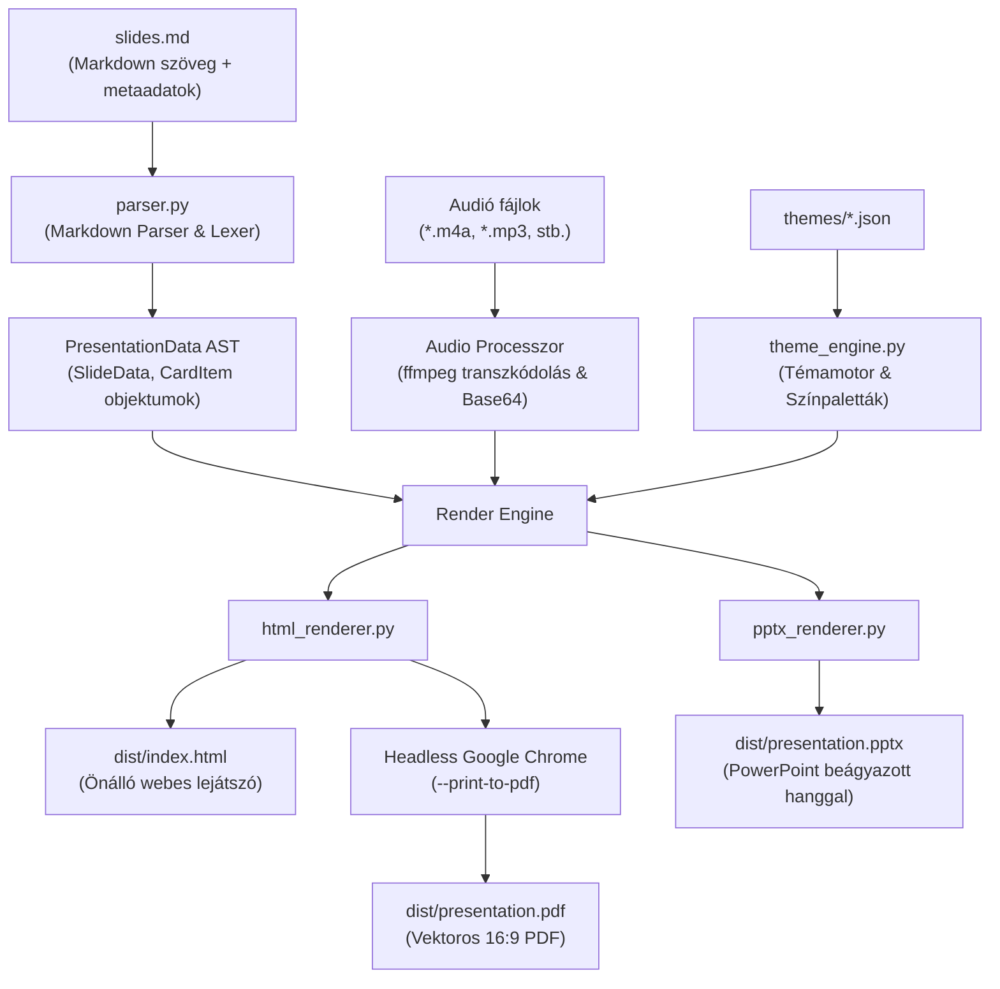

# Rendszerarchitektúra és Működési Dokumentáció

Ez a dokumentum részletesen bemutatja a **Slideshow Generator** belső felépítését, technológiai hátterét és adatfolyamát.

---

## 1. Rendszer-áttekintés (System Overview)

A projekt célja, hogy egyszerű, ember által vagy AI modellek által írt Markdown vázlatokból (`slides.md`) és tetszőleges hangfájlokból (`.m4a`, `.mp3`) teljesen automatikusan, emberi beavatkozás nélkül hozzon létre professzionális, 16:9 arányú prezentációkat három független kimeneti formátumban:

1. **Microsoft PowerPoint (`presentation.pptx`)**: Szabványos prezentáció beágyazott natív médiaobjektummal (kattintásra induló hanggal).
2. **Interaktív Webes Prezentáció (`index.html`)**: Önálló, függőségmentes HTML5/CSS3/JavaScript diavetítő beágyazott audióval, valós idejű idősávval, billentyűzet-vezérléssel és kártyás elrendezéssel.
3. **Vektoros PDF (`presentation.pdf`)**: Pixelpontos, 16:9 képarányú, nyomtatható és vetíthető PDF változat.

---

## 2. Architektúra és Adatfolyam

A generátor egy determinisztikus, többlépcsős feldolgozó futószalagot (pipeline) alkalmaz:



---

## 3. Komponensek és Mappastruktúra

```
slideshowGenerator/
├── docs/                       # Rendszer- és architektúra dokumentáció
│   ├── ARCHITECTURE.md         # Részletes technológiai háttér és működés
│   └── DECISIONS.md            # Kulcsfontosságú tervezési döntések (ADR)
├── generator/
│   ├── models.py               # AST adatmodellek (SlideData, CardItem, ThemeConfig)
│   ├── parser.py               # Markdown feldolgozó, diák és kártyák értelmezése
│   ├── theme_engine.py         # JSON témák betöltése, validációja és kezelése
│   ├── theme_generator.py      # AI és algoritmikus stílusgeneráló motor
│   ├── themes/                 # Deklaratív JSON stílusdefiníciók
│   │   ├── schema.json         # JSON Schema a témák validálásához
│   │   ├── modern_clean.json   # Alapértelmezett modern világos stílus
│   │   ├── dark_mode.json      # Prémium sötét téma
│   │   ├── emerald_growth.json # Természetes smaragdzöld téma
│   │   ├── warm_academic.json  # Meleg akadémiai stílus
│   │   └── THEME_PROMPT.md     # Útmutató és prompt sablon új AI témákhoz
│   ├── renderers/              # Formátum-specifikus generáló modulok
│   │   ├── html_renderer.py    # Interaktív webes diavetítő generátor
│   │   ├── pptx_renderer.py    # PowerPoint fájl generátor (python-pptx)
│   │   └── pdf_renderer.py     # Chrome headless PDF konvertáló
│   └── cli.py                  # CLI interfész és azonnal újrahasznosítható webszerver
├── slideshow_1/                # Példa diasor
│   ├── slides.md               # Forrás diák metaadatokkal
│   ├── slide_title.m4a         # Eredeti hangfelvétel
│   └── dist/                   # Generált kimenetek (git által figyelmen kívül hagyva)
├── run.py                      # Futtató wrapper automatikus .venv detektálással
├── requirements.txt            # Python függőségek
├── AGENTS.md                   # AI ügynökök szabályzata és karbantartási útmutatója
└── README.md                   # Felhasználói útmutató
```

---

## 4. Részletes Modulleírások

### 4.1. Parser és Belső AST (`generator/parser.py`, `models.py`)
- **Diahatárolók felismerése**: Támogatja a `# Title`, `# Slide` és `---` jelöléseket.
- **Metaadat kinyerése**:
  - `<!-- audio: fajlnev.m4a -->`: Csatolt hangfelvétel.
  - `<!-- notes: ... -->`: Előadói jegyzetek.
  - `<!-- type: ... -->`: Kézi dia-típus felülbírálás.
- **Tartalmi felismerés és kártyásítás**:
  - Ha a dián pontok szerepelnek (`- Cím: Leírás`), a parser automatikusan `CardItem` objektumokká alakítja őket.
  - **Folytonos számozás**: Ha egymás után több kártyás dia következik (pl. kategóriák 1. és 2. része), a parser átviszi a számlálót, így az 1. dián `01, 02`, a 2. dián pedig `03, 04` jelvények jelennek meg.
  - **Definíciós dia**: Ha a dián nincsenek felsoroláspontok, csak egy terjedelmes folyószöveg, azt kiemelt idézet/definíció kártyává formálja.

### 4.2. Stílusmodul (`generator/themes/`, `theme_engine.py`)
- A témák teljesen függetlenek a kódtól és a diasor tartalmától.
- Minden téma egy tiszta, deklaratív JSON fájl, amely tartalmazza:
  - Színpalettát (háttér, kártya, szegély, elsődleges/másodlagos szöveg, kiemelő szín, jelvények).
  - Tipográfiát (cím és törzs betűcsalád).
  - Geometriát (kártya lekerekítés `border-radius`, árnyékok, szegélyvastagság).
- **AI Témagenerálás (`theme_generator.py`)**: Ha van `GEMINI_API_KEY`, meghívja az LLM-et; ha nincs, egy algoritmikus stílusszintetizáló elemzi a kulcsszavakat (pl. "neon", "sötét", "zöld", "skandináv"), és azonnal létrehozza az új stílus JSON fájlját.

### 4.3. Webes Renderelő (`generator/renderers/html_renderer.py`)
- **Zero-Dependency önálló HTML**: A hangfájlokat a generátor automatikusan Base64 formátumban (`data:audio/mpeg;base64,...`) közvetlenül a HTML-be ágyazza. Ezáltal a fájl bárhova másolható, és elkerüli a böngészők helyi `file://` biztonsági korlátozásait.
- **Automatikus MP3 transzkódolás**: Ha a rendszeren elérhető az `ffmpeg`, a telefonos vagy nem szabványos hangfájlokat (pl. Samsung `3gp4` M4A konténer) azonnal univerzális MP3-má konvertálja.
- **Többszintű `<audio>` fallback**: A böngésző sorban próbálja: Base64 MP3 -> helyi MP3 -> eredeti M4A.
- **16:9 arányú nézet**: CSS `aspect-ratio: 16/9; width: min(100vw, calc(100vh * 16 / 9));`.
- **Interakció**: Billentyűzetkezelés (nyilak, szóköz, PgUp/PgDown, 'F' teljes képernyő), valós idejű lejátszási idősáv (`Lejátszás (0:02 / 0:07)`), animált hanghullámok.

### 4.4. PowerPoint Renderelő (`generator/renderers/pptx_renderer.py`)
- A `python-pptx` könyvtár segítségével 16:9 szélesvásznú (13.333 × 7.5 hüvelyk) vásznat épít.
- A kártyákat és definíciós dobozokat vektoros lekerekített téglalapokként rajzolja fel a téma színeivel.
- A hangfájlokat natív médiaobjektumként csomagolja a `.pptx` ZIP archívumba (`ppt/media/media1.m4a`), és egy hangszóró ikont helyez el a dia jobb felső sarkában kattintásra induló lejátszással (`<p14:media>` és `<a:hlinkClick action="ppaction://media">`).

### 4.5. PDF Renderelő (`generator/renderers/pdf_renderer.py`)
- A HTML-ben elhelyezett `@media print { @page { size: 16in 9in; margin: 0; } }` stíluslapot kihasználva meghívja a rendszerszintű Headless Google Chrome-ot:
  ```bash
  google-chrome-stable --headless=new --disable-gpu --no-pdf-header-footer --print-to-pdf=dist/presentation.pdf dist/index.html
  ```
- Az eredmény egy 100%-ban pixelpontos, vektoros szövegeket tartalmazó 16:9-es PDF.

### 4.6. Reusable CLI Webszerver (`generator/cli.py`)
- A beépített `--serve` parancs a kimeneti mappát szolgálja ki egy helyi HTTP szerveren.
- **Azonnali port-újrahasznosítás**: A `ReusableTCPServer` osztály beállítja a `SO_REUSEADDR` és `SO_REUSEPORT` kernel flag-eket, és `Ctrl + C` esetén azonnal lezárja a socketet (`server.server_close()`), megszüntetve a Linux `TIME_WAIT` port-beragadását.
