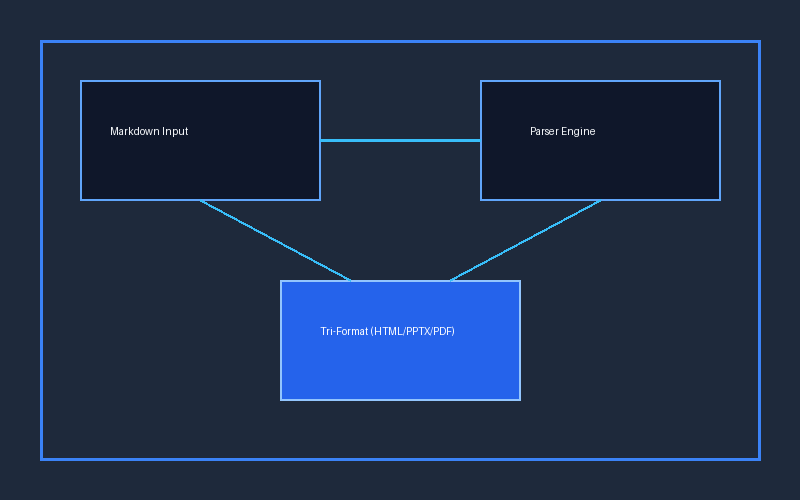

# Modern Markdown Bemutató
Készítette: Antigravity AI

---

## A Tudás Alapjai
> A tudás nem más, mint a valóság **pontos és strukturált** megértése, amely a tapasztalatokból és a folyamatos *kísérletezésből* táplálkozik.

---

## Főbb Rendszerkomponensek

### Frontend Player
Böngészőben futó **önálló HTML5 lejátszó**, amely nem igényel külső szervert vagy internetkapcsolatot.

### PowerPoint Export
Natív OpenXML formátum, amely `python-pptx` segítségével hoz létre **szerkeszthető alakzatokat** és beágyazott hangot.

---

## Python Algoritmus Példa

```python
def generate_slides(markdown_text: str) -> None:
    # Intelligens parser és fordító pipeline
    slides = parse_markdown(markdown_text)
    for slide in slides:
        render_tri_format(slide)
```

---

## Formátum-összehasonlító Táblázat

Az alábbi táblázat bemutatja az egyes kimeneti formátumok legfőbb tulajdonságait:

| Formátum | Motor / Technológia | Hangkíséret | Függőségmentes |
| :--- | :---: | :---: | ---: |
| HTML5 Player | Natív ES6 + Web Audio | Base64 MP3 | 100% Önálló |
| PowerPoint (.pptx) | OpenXML / python-pptx | Beágyazott média | Szerkeszthető |
| Vektoros PDF | Headless Chromium (16:9) | Nem releváns | Nyomtatható |

---

## Rendszerarchitektúra Áttekintés

A háromcsatornás renderelési architektúra sematikus ábrája:



---

## Tervezési Alapelvek

A generátor szigorú specifikáció szerint működik:
- **Tri-Format paritás**: Minden megjelenítési forma azonos vizuális élményt ad.
- *Gyors fordítás*: Pár másodperc alatt elkészül az összes formátum.
- `file:///` kompatibilitás: A böngésző nem blokkolja a helyi forrásokat.


---

## Kiterjesztett Markdown és Feladatlista

A rendszer támogatja a legújabb tipográfiai elemeket és feladatlistákat:
- ~~Elavult monolitikus felépítés~~ helyett modern moduláris motor
- ==Kiemelt fontosságú== vizuális elemek és fókuszpontok
- Kémiai képletek: H~2~O és matematikai hatványok: E = mc^2^
- [x] Tri-Format paritás biztosítása (HTML, PPTX, PDF)
- [x] Képek és táblázatok natív renderelése
- [ ] További témasablonok készítése
